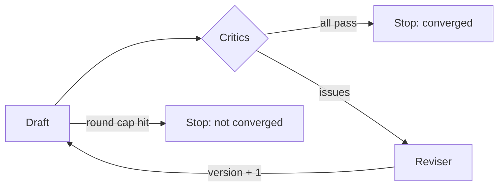

# CriticLoop AI

**A self-correcting refinement loop where deterministic critics — not vibes — decide when a draft is done.**

Multi-agent demos usually end with a model saying "looks good to me". CriticLoop
inverts that: the *stopping condition* is a set of small, auditable checks, and a
reviser has to satisfy them. If it cannot, the loop stops at a hard round cap and
says so, instead of looping forever or declaring success.

[](https://github.com/abubakarsiddique360/CriticLoop-AI/actions/workflows/ci.yml)
[](pyproject.toml)
[](LICENSE)
[](pyproject.toml)

## Quick start

```bash
git clone https://github.com/abubakarsiddique360/CriticLoop-AI.git
cd CriticLoop-AI
python -m venv .venv
# Windows: .venv\Scripts\activate     macOS/Linux: source .venv/bin/activate
pip install -e ".[dev]"

criticloop demo
criticloop run examples/incident-missing-root-cause.json
```

```
Converged: True after 2 round(s)

round 1: score 0.60
  - [required-sections] missing section: Root cause
  - [max-words] too long: 171 words (limit 160)
round 2: score 1.00
```

## The loop



```python
from criticloop.critics import RequiredSections, MaxWords
from criticloop.loop import refine
from criticloop.types import Draft

trace = refine(
    Draft(text="# Draft\n\nSome text."),
    critics=[RequiredSections(("Timeline",)), MaxWords(120)],
    reviser=lambda draft, issues: Draft(text=draft.text + "\n\n## Timeline\n\n- ..."),
    max_rounds=3,
)
assert trace.converged
```

Every round is recorded: draft version, score, issues, duration. `trace.as_dict()`
is the audit log.

## Critics

| Critic | Fails when |
| --- | --- |
| `RequiredSections` | an expected `##` heading is missing |
| `RequiredTerms` | a required phrase is absent |
| `ForbiddenTerms` | hedging language appears ("probably", "I think") |
| `MaxWords` | the draft is over budget |
| `MaxSentenceWords` | a single sentence is too long |
| `NoRepeatedSentences` | the same sentence appears twice |

Score = critics passed ÷ critics run. Convering on `1.0` means *every* rule
passed; a target of `0.8` is allowed when one rule is advisory.

## The bundled task: incident summaries

`criticloop run examples/incident.json` builds a postmortem-style summary from a
structured event list. Two scenarios are included on purpose:

- `incident.json` — includes a root cause, converges in **one** round.
- `incident-missing-root-cause.json` — no root cause is known. The solver omits
  the section, the critic flags it, and the reviser adds
  *"Not yet confirmed. The incident stays open until the cause is proven by
  evidence."* — an honest placeholder instead of an invented cause.

That is the design goal in one example: **self-correct without fabricating.**

## CLI

| Command | Purpose |
| --- | --- |
| `run FILE [--json] [--max-rounds N] [--word-limit N]` | Refine an incident summary |
| `demo` | Run the built-in sample incident |
| `critics` | List the critics in use |

Exit codes: `0` when the loop finishes (converged or capped — check the trace),
`2` for malformed input.

## Project layout

```text
src/criticloop/
├── types.py     Draft · Verdict · Round · Trace
├── critics.py   six deterministic critics + scoring
├── loop.py      refine(): evaluate → revise → repeat
├── tasks.py     incident summariser (solver + reviser)
└── cli.py       run · demo · critics
examples/        two incidents: with and without a known root cause
tests/           30 pytest cases
```

## Design notes

- **Deterministic stopping condition.** No model can declare victory; only the
  critics can, and their rules are unit-tested.
- **Bounded by construction.** `max_rounds` is required to be at least 1 and the
  loop never exceeds it — no runaway agent cost.
- **Revisers are pluggable.** Pass any callable `(draft, issues) -> Draft`. Swap
  in an LLM call without touching the loop or the critics.
- **Issues are strings with a `[critic]` prefix.** They read well in a terminal
  and travel well into a prompt if a model does the revision.

## Limitations

- Critics check *form*, not truth. `RequiredTerms` cannot tell whether a number is
  correct, only whether it is present.
- A reviser that only appends text will happily pad a draft; the word budget and
  the round cap are what keep that honest.
- No async or parallel critics: with a handful of cheap regex checks, serial is
  faster than the coordination cost.

## License

[MIT](LICENSE) © 2026 **ABU BAKAR SIDDIQUE**
